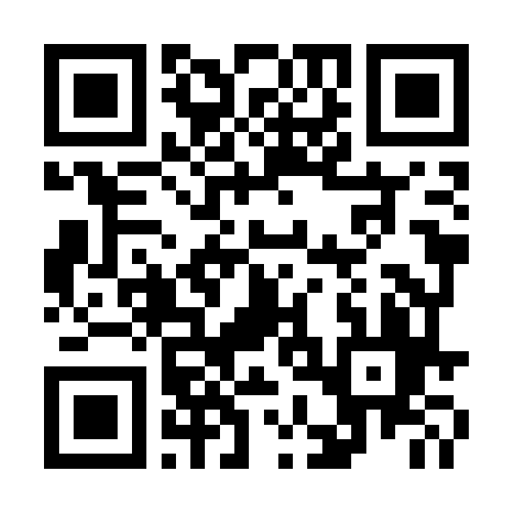
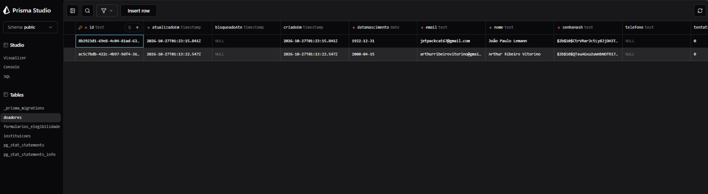

# VITTA

Aplicativo de incentivo à doação de sangue, feito para a disciplina de Projeto de Software (UCB).

A ideia é facilitar a doação e deixar o hábito mais divertido: a pessoa descobre se já pode doar, encontra os hemocentros mais perto e, quanto mais doa, mais pontos e recompensas ganha.

## Experimente

- **Versão web:** https://vitta-app-ucb.onrender.com (abre no navegador do computador ou do celular)
- **API (teste de saúde):** https://vitta-api-ucb.onrender.com/health



Duas observações:

- O servidor está no plano grátis da Render e dorme depois de 15 minutos sem uso. Na primeira visita ele pode levar cerca de 1 minuto para acordar (o app avisa "Acordando o servidor" e tenta sozinho).
- Na versão web o mapa aparece como um quadro explicativo. O mapa completo está no aplicativo, no Expo Go.

## O que já funciona

| Parte | O que faz |
|---|---|
| Boas-vindas | Carrossel na primeira vez que o app abre: por que doar, a ideia do app e como ele funciona |
| Cadastro e login (HU-01) | Conta com e-mail e senha, login com token (JWT) e bloqueio depois de 5 erros de senha |
| Excluir conta (HU-02) | Apaga a conta e todos os dados |
| Formulário de elegibilidade (HU-03) | Perguntas rápidas sobre saúde; diz se a pessoa já pode doar ou a partir de que dia (Portaria GM/MS 11.685/2026) |
| Mapa com instituições (HU-05) | Instituições de coleta perto da pessoa, raio de busca, busca por nome, detalhes e tipos de sangue em falta (sem o botão de agendar, que vem com a HU-04) |
| Perfil (HU-11) | Telefone e tipo sanguíneo |
| Controle de acesso (RNF-002) | Cada doador só enxerga e altera os próprios dados |
| Localização (RNF-008) | Pede permissão, avisa quando o GPS está desligado e mantém a busca por nome |

Ainda não existem: agendamento (HU-04), histórico, notificações e pontos/recompensas.

As instituições do mapa são 1 real (Hemocentro de Brasília) e 7 de demonstração, que são fictícias e aparecem marcadas assim no app.

## Banco de dados

O banco é PostgreSQL e está publicado na Render. A imagem mostra as tabelas vistas pelo Prisma Studio; as contas que aparecem são de teste.



- `doadores`: as contas. A senha nunca é guardada, só o hash (bcrypt).
- `formularios_elegibilidade`: o último formulário respondido por cada doador.
- `instituicoes`: as instituições do mapa.
- `_prisma_migrations`: o histórico das alterações do banco. As tabelas `pg_stat_*` são da própria Render.

## Tecnologias

- **Aplicativo** (`frontend/`): Expo SDK 58, React Native 0.88, TypeScript, React Navigation.
- **API** (`backend/`): Node 22, Express 5, TypeScript, Prisma 7, PostgreSQL 16, Zod, JWT.
- **Infraestrutura**: Docker e Docker Compose; publicação na Render.
- **Testes**: Vitest e Supertest (377 testes automáticos).

```
vitta/
  backend/      a API (rotas, serviços, banco, testes)
  frontend/     o aplicativo (Expo / React Native)
  documentos/   documentos do projeto, pesquisas e evidências das entregas
  docker-compose.yml   banco de dados (e a API, se quiser rodar tudo em containers)
  render.yaml   receita da publicação na internet
```

## Rodar no seu computador

Precisa de: Docker Desktop, Node 22 (ou mais novo) e o app Expo Go no celular (versão do SDK 58).

1. **Banco de dados.** Na pasta do projeto: `docker compose up -d db`
2. **API.** Em `backend/`:
   - `npm ci`
   - copie `.env.example` para `.env` (o valor padrão já funciona com o banco acima)
   - `npx prisma migrate deploy` e `npm run seed` (cria as tabelas e carrega as instituições do mapa)
   - `npm run dev` (a API fica em http://localhost:3000; teste em http://localhost:3000/health)
3. **Aplicativo.** Em `frontend/`:
   - `npm ci`
   - copie `.env.example` para `.env` e troque o endereço pelo IP do seu computador na rede (ex.: `http://192.168.0.10:3000`)
   - `npx expo start -c` e leia o QR code com o Expo Go (celular e computador na mesma rede, ou use `npx expo start --tunnel`)

Para rodar API e banco juntos em containers: `docker compose up --build` (a API aplica as migrações e carrega as instituições sozinha).

## Testes

Em `backend/`, rode `npm test`. São 377 testes, com banco de dados de verdade, cobrindo cadastro, login, controle de acesso, formulário de elegibilidade, mapa e CORS.

## Publicação na internet

O site e a API ficam na Render, no plano grátis, descritos pelo arquivo `render.yaml`. O passo a passo, os cuidados do plano grátis e como ver o banco da Render estão em [PUBLICACAO.md](PUBLICACAO.md).

## Documentação e evidências

- `documentos/DOCX` e `documentos/PDFs`: visão, requisitos, casos de uso, arquitetura e guia de estilo.
- `documentos/pesquisa`: pesquisa sobre os formulários de triagem de doação de sangue.
- `documentos/evidencias/iteracao-2` e `iteracao-3`: relatórios de testes, consultas ao banco e roteiros de gravação das entregas.
